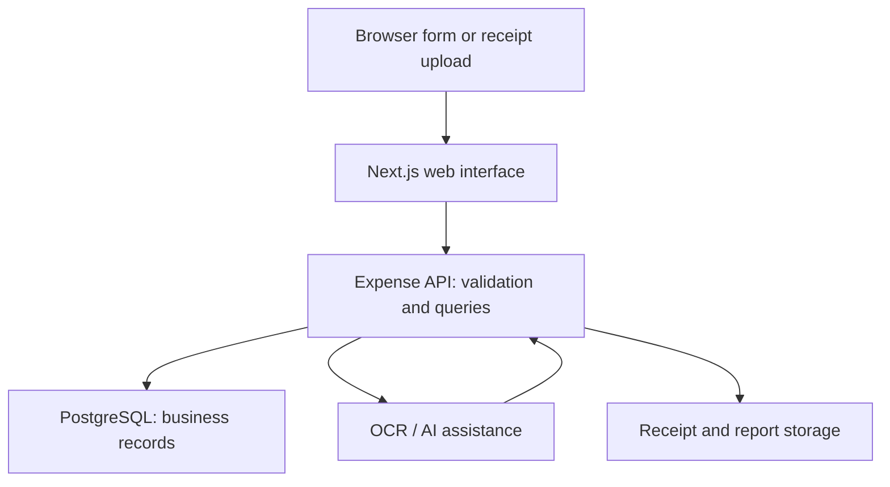
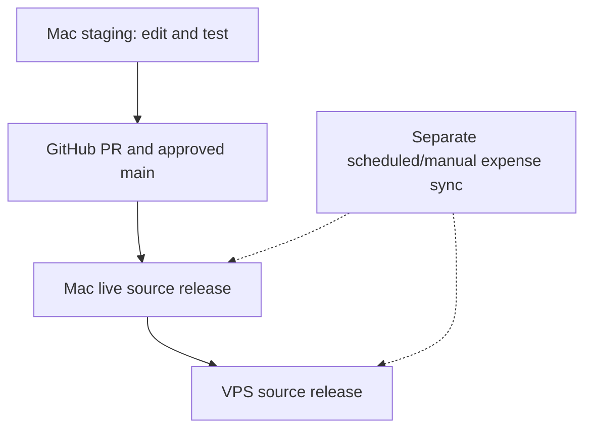

# 02 — Coding and architecture basics

[Handbook index](README.md)

## Vocabulary first

| Word | Meaning here |
| --- | --- |
| Source code | Human-readable files developers edit |
| Frontend | Browser interface: forms, receipt views, reports and menus |
| Backend/API | Server code validating requests and reading/writing data |
| Request | A browser asking a service to do something |
| Database | Persistent structured business records |
| Schema | Table, column, index, constraint and trigger definitions |
| Migration | A reviewed change to that schema |
| Image | Built, packaged application used to create a container |
| Container | A running instance of an image |
| Volume/bind mount | Persistent storage attached to a container |
| Repository | Version-controlled source files and history |
| Commit | One recorded source snapshot with a unique identifier |
| Branch | A movable name for a sequence of commits |
| Pull request (PR) | Proposed branch changes reviewed before merge |
| CI | Automated GitHub source checks |
| Artifact | An exact packaged source release identified by a checksum |
| Health check | A check that a service responds with the expected result |
| Tombstone | A retained deletion marker used during synchronization |
| Idempotent | Safe to repeat without creating duplicate effects |
| Fence/permit | A mechanism restricting writes; prototypes exist, production gating does not |

## Expense request flow

A typical receipt journey is: choose an image, upload/process it, extract candidate fields, review payer/date/merchant/currency/amount, then save. OCR is an assistant, not final financial evidence. A valid-looking model response still needs the operator's review. An upload file and an expense row are different objects; not every uploaded file is necessarily referenced by a saved expense.

Expense reports query stored records. Excel export is an output file, not the authoritative database. Do not repair a report by editing a generated spreadsheet while leaving the source expense wrong.

## Nine applications in the managed release

| Module | Source directory | Responsibility |
| --- | --- | --- |
| Expense API | `apps/api` | Expenses, metadata, uploads, reports and company funds |
| Expense web | `apps/web` | Next.js/React interface and module proxy routes |
| OCR | `services/ocr` | Receipt image text processing |
| Phone queue | `services/phone-queue` | Phone receipt capture/queue behavior |
| Inventory API | `services/inventory-api` | Inventory operations and independent tables |
| Keg API | `services/keg-api` | Stations/readings and keg functions |
| Social API | `services/social-api` | Social content/settings/assets |
| Oak AI | `services/oak-ai` | AI assistance using an external Ollama endpoint |
| Restaurant | `restaurant` | Public website, admin, menus, events and SQLite data |

Common internal ports include expense API 4000, web 3000, inventory 4200, keg 4200, social 4500, Oak AI 4400 and restaurant 3080. Internal ports can be reused across separate containers; host-published ports must not collide. Do not infer host ports from these numbers.

The web's module routes include `/module-api/inventory/`, `/module-api/keg/`, `/module-api/social/` and `/module-api/ai/`. Their rewrites are compiled into the web build. A running module does not prove the web proxy reaches it; both paths are tested during release.

PostgreSQL, Caddy, VPN containers and the separate Ollama engine are infrastructure. The nine-app deployment does not upgrade them. Mac AI may use `host.docker.internal` and a different installed model from VPS. Same source does not require identical host-specific environment values.

## Where to edit

| File/folder | Start here when changing |
| --- | --- |
| `apps/web/app/page.js` | Main expense interface/navigation |
| `apps/web/app/company-funds/page.js` | Company-funds interface |
| `apps/api/src/index.js` | Expense routes and funds feature wiring |
| `apps/api/src/company-funds.mjs` | Funds HTTP handlers and SQL |
| `apps/api/src/company-funds-model.mjs` | Exact money parsing and settlement calculations |
| `apps/api/src/automation-bridge.mjs` | Expense synchronization operations; requires protocol review |
| `apps/api/src/expense-sync-scope.mjs` | Explicit tracked and independent table boundaries |
| `apps/api/src/automation-schema.sql` | Synchronization trigger/schema initialization |
| `automation/merge.py` | Pure record merge rules |
| `automation/runner.py` | Existing sync scheduler, journals and lock handling |
| `automation/machine.py` | Local Docker/bridge operations |
| `db/migrations` | Reviewed schema changes |
| `.github/workflows/checks.yml` | GitHub Source checks |
| `restaurant/server.mjs` | Restaurant HTTP handlers, SQLite/admin behavior |
| `restaurant/public` | Restaurant browser interface and static assets |
| `restaurant/scripts` | Local preview/promotion, backup and release helpers |
| `scripts` | Staging starters and integration tests |
| `tools/release-console` | Locally installed control source; may not be Git-tracked |

Older patch folders, loose duplicate page files and previous restaurant copies may be historical. Follow imports and the Docker build context before choosing a file. Editing a similarly named backup file does not update the running application.

## Data stores are separate

Expense/module tables share a PostgreSQL deployment but have deliberately separate sync scopes. Restaurant uses its own SQLite database and media store. Logs, admin sessions and caches are not the same as business content. Git stores none of the live database rows, upload folders, private sessions or passwords.

A container rebuild replaces application code. Persistent mounts retain data. Deleting a container is not the same as deleting a volume, and commands that remove volumes can destroy the database. Existing deployment captures and preserves installed mounts rather than inventing new storage paths.

## Code flow and data flow are different

Only the dotted data process transfers the supported records/receipts. Code promotion never copies staging test records into either live database.
