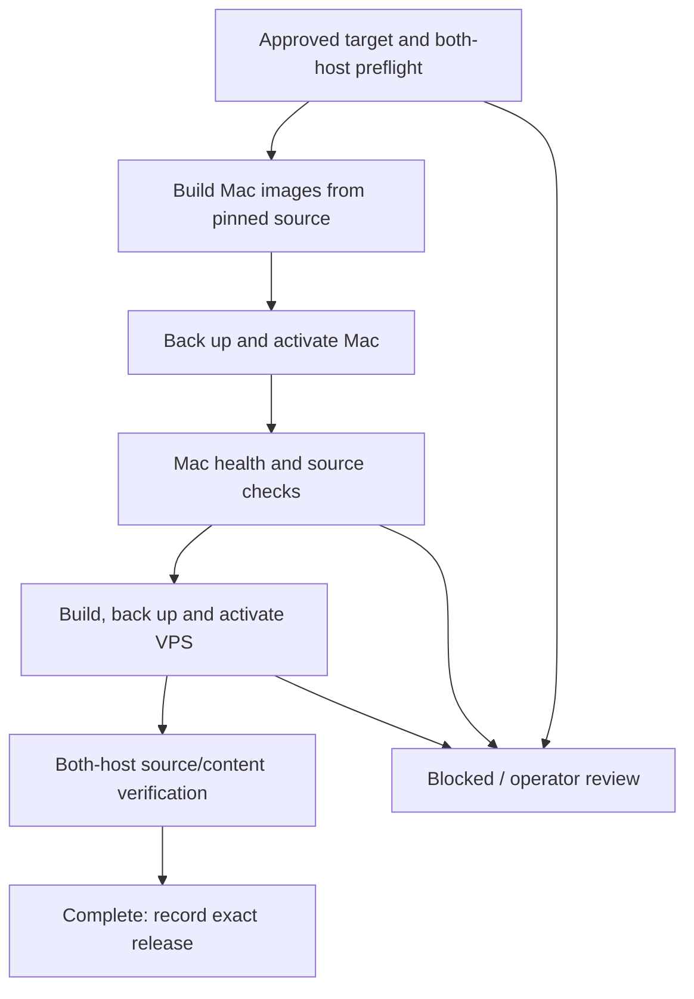

# 05 — Approved deployment

[Handbook index](README.md)

## The current mechanism

There are two installed workflows with different responsibilities:

| Workflow | Purpose | Normal control |
| --- | --- | --- |
| Existing OakAutomation engine | Daily/manual expense and company-funds data sync | Installed `engine/runner.py` and its existing scheduler |
| Separate approved-code job | New approved-main application source releases | Installed `automatic-code/service/manage.py` and its own LaunchAgent |

Keep the old engine's `approved-main-v1` deployment policy disabled. Enabling it would create a second, obsolete code-deployment path. Pausing the new code job does not intentionally disable data sync, although an active operation can temporarily hold the shared lock.

## What automatic means

The new user LaunchAgent is named `online.the-oak-lounge.approved-code`. It uses a 300-second interval and runs at login/load. Docker, Git/GitHub CLI authentication, network and the signed-in Mac user session must be usable. An asleep/off Mac cannot orchestrate a release. There is no promise of a release at an exact second; a build, lock contention, offline host or failed check can delay it.

The stable installed runtime is outside the Git checkout. It does not disappear when a developer changes branches. It also does not automatically update itself from a Git pull. A future runtime upgrade needs its own reviewed installer/update plan.

## Before a new release

The worker requires matching managed deployed records and the current healthy source baseline. It checks for pending sync work, conflicts and an active manual/coordinated workflow. It rejects old legacy deployment enabled in parallel.

It fetches `origin/main`, checks the expected repository, successful `Source checks` and no pending/failing commit checks, and requires an exact merged PR into main. The new target must descend from the deployed source. Direct main pushes do not satisfy this release policy.

Changed source paths are checked. Sync bridge/scope/initialization changes, automation, unsupported infrastructure and unknown top-level paths require manual review. Changes to database initialization/migration fingerprints block automatic deployment. Because fingerprints include whole source files containing DDL, an apparently small source edit can be conservatively blocked.

For a new target, fresh read-only source/content checks must match on both hosts before activation. An unchanged target causes no build; it does not run a full business-content observation every five minutes. Use `manage.py check` when you need an explicit full current observation.

## Release stages



The coordinator holds the existing `runner.lock` through both host stages. This prevents the normal data-sync runner and manual release process from overlapping it. It is not a transaction across two databases or a lock against every browser/administrator write.

All nine application images are built from one pinned source archive. Mac and VPS build for their own architectures; their Docker image IDs need not match. The source commit and artifact digest must match. Live environment, credentials, mounts, ports and network aliases are captured and preserved. Unsupported custom configurations are rejected rather than guessed.

Before host activation, application writers are stopped for backup and replacement. Backups validate the database dump and writable stores, including restaurant SQLite/media. PostgreSQL, Caddy, VPNs and Ollama are not upgraded. Activation checks running image IDs and API/web/OCR/phone/module routes; VPS checks also include restaurant gateway/public access.

In automatic mode, passed Mac health checks lead directly to VPS deployment. There is no additional manual visual-review pause. In manual-console mode, Mac review is an explicit separate step. Operators should still inspect both websites after a successful automatic release.

## Commands on the configured Mac

Read status without deploying:

```bash
python3 "$HOME/Library/Application Support/OakAutomation/automatic-code/service/manage.py" status
```

Full read-only readiness check:

```bash
python3 "$HOME/Library/Application Support/OakAutomation/automatic-code/service/manage.py" check
```

Enable (rechecks readiness and registers/enables the job):

```bash
python3 "$HOME/Library/Application Support/OakAutomation/automatic-code/service/manage.py" enable
```

Pause future automatic releases:

```bash
python3 "$HOME/Library/Application Support/OakAutomation/automatic-code/service/manage.py" disable
```

Disable does not kill an in-flight deployment. Wait for its recorded outcome before maintenance. It does not roll back an existing release or switch off the existing data scheduler.

Watch progress, Mac, observation only:

```bash
tail -n 80 -f "$HOME/Library/Application Support/OakAutomation/automatic-code/stdout.log"
```

Press Ctrl+C to stop **tail** only. Do not confuse stopping a log viewer with terminating the actual deployment worker. Private error output is in `stderr.log` in the same folder. Redact logs before sharing.

## Interpret output correctly

| Field/state | Meaning |
| --- | --- |
| `enabled: true` | Job enabled; not proof every tick succeeded |
| `phase: checked`, `read_only: true` | A verification completed without activation |
| `would_deploy: false` | Approved main already equals recorded deployed commit |
| `source_data_verified: true` | This operation performed the full scoped observation |
| `phase: unchanged` | No target change; no build/activation |
| `phase: busy` | Shared operation lock held; worker waits for a later tick |
| `phase: blocked` | Prerequisite failed before rollout; see error |
| `phase: complete` | Exact automatic release completed and verified |
| `phase: attention_required` | A started release failed/was uncertain; no blind timer retry |
| `continuous_write_fencing_enabled: false` | Production strict data gate remains absent |

After a started failure, an enable command does not erase recovery state. Do not delete `job.json` or rewrite commits/hashes to make it green. Use [recovery](08-recovery.md).

## Manual release console

For operator review/recovery, on Mac:

```bash
cd "$HOME/Desktop/oak-expense-v1"
python3 tools/release-console/serve.py
```

Open the URL printed by the process, normally http://127.0.0.1:3192. It is loopback-only. Starting it alone does not deploy; clicking release actions can. Keep the process open for the manual workflow. Its startup is separate from the new background worker; this handbook does not claim it starts automatically.

Manual Mac/VPS actions must be coordinated with the enabled background job. Disable future automatic releases, wait until any active job finishes, then inspect workflow/host status. The shared lock prevents simultaneous actions but does not make conflicting operator intentions safe.

## Documentation-only merges

The current worker accepts `docs/` changes, but still identifies the new main commit as a new source target and can rebuild/deploy all nine applications. A documentation-only commit is not currently optimized into a zero-restart release. If that restart is undesirable, disable the automatic-code job before merging documentation and plan when to re-enable; do not simply alter deployed commit records. A future documentation-only optimization is in the roadmap.
